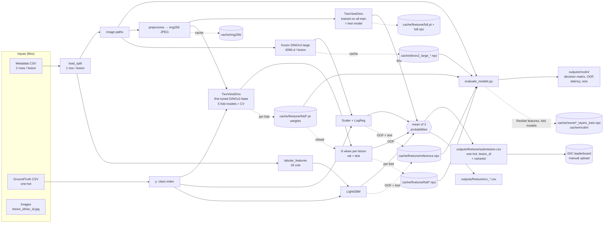

# Architecture

## 1. System overview

This is an offline **machine‑learning research pipeline**, not a service: there is no server, database, auth or runtime API. Data enters as files (images + CSVs), passes through a batch **pipeline of stages** (load → featurise → train with k‑fold CV → ensemble → write CSV), and leaves as a submission file uploaded by hand to the ISIC leaderboard. A second, offline path (`evaluate_models.py`) turns the cached out‑of‑fold predictions into comparison tables for multi‑criteria decision making (MCDM).

Design principles visible in the code:

- **Late fusion of models.** Each image model sees both views (clinical and dermoscopic) and concatenates their features; the metadata gets its own model. Models are combined by averaging class probabilities with fixed equal weights.
- **One fixed evaluation protocol.** Lesion‑level `StratifiedKFold(5, shuffle=True, random_state=42)` is shared by every experiment so results are directly comparable. Anything tuned on data is measured with nested CV (`history.md`).
- **Cache expensive stages to disk.** Frozen features, resized images, reference‑model predictions, fine‑tuned fold weights (`fold{k}.pt`) and their predictions are saved as `.npz`/`.pt`/JPEG so notebooks are resumable and cheap to re‑run.
- **Notebooks as the unit of work, shared code in modules.** Each notebook reads top‑to‑bottom. Code that both notebooks must agree on (data loading, tabular features, folds, reference models) lives once in `common.py`, so the "same folds, same features" guarantee cannot drift. Code that *must* live in a module for DataLoader worker pickling on Windows is in `ft_data.py`. `evaluate_models.py` imports both modules; the few definitions that live inside notebook cells are copied into it and guarded by cache consistency checks.

The only implementation is `main_code/`. It is single‑label (softmax/argmax), uses StratifiedKFold, and writes one‑hot `lesion_id,…` submissions. An earlier EfficientNet‑B0 script pipeline and its weights are no longer in the working tree; they survive only in git history (commit `91f9cf46`).

## 2. Component breakdown

### `main_code/notebooks/common.py` — shared by both notebooks and `evaluate_models.py`

| Name | Responsibility |
|---|---|
| `CLASSES`, `IMAGE_TYPES`, `N_FOLDS = 5`, `SEED = 42` | Class order (= GroundTruth column order), image‑type → view key (`clin`, `derm`), protocol constants. |
| `load_split(data, split)` | Reads `MILK10k_{split}_Metadata.csv` (2 rows per lesion) and pivots to **one row per lesion**: patient fields (`age_approx, sex, skin_tone_class, site`), 7 MONET scores × 2 views (`clin_MONET_*`, `derm_MONET_*`), and image paths (`clin`, `derm`). |
| `lesion_ids(df)` | Lesion ids as a plain numpy `<U` array for the lesion‑id checks stored in `.npz` caches (`df.index.values.astype(str)` yields a pandas array on pandas 3, which `np.savez` pickles and `np.load` then refuses). |
| `load_labels(data, index)` | One‑hot GroundTruth → class index `y` (0–10), aligned to `index`; asserts the column order equals `CLASSES`. |
| `tabular_features(df, sites)` | Drops path columns; makes `sex`/`site` pandas categoricals with fixed categories (LightGBM handles them and NaNs natively). 18 features. |
| `make_folds(y)` | The shared `StratifiedKFold(5, shuffle=True, random_state=42)` split. Depends only on `y`, so it is identical to the old `split(X_tab, y)` calls. |
| `tabular_model()`, `image_model()` (= `frozen_model`) | `LGBMClassifier(balanced, 300 trees)`; `StandardScaler + LogisticRegression(C=0.03, balanced)`. |
| `take`, `oof_proba(make_model, X, y, folds)` | Row selection for DataFrame/array; out‑of‑fold probabilities over the shared folds. |

### `main_code/notebooks/01_baseline.ipynb` — frozen baseline

| Step | Function(s) | Responsibility |
|---|---|---|
| Load + labels + tabular | `load_split`, `load_labels`, `tabular_features` (`common.py`) | One row per lesion, class index `y`, 18 tabular features. |
| Image features | `cnn_features`, `image_features` | Frozen `facebook/dinov2-large`: CLS + mean patch token = 2048 per image → 4096 per lesion. ResNet50/101 multi‑layer GAP is a switchable alternative (`BACKBONE`). Cached in `outputs/cache/{name}_{split}.npz` with a lesion‑id check. |
| CV | `make_folds`, `oof_proba` (`common.py`), `scores` | Out‑of‑fold probabilities over the shared folds; macro‑F1, fold std, balanced acc, macro AUC, accuracy. |
| Fusion + submit | – | `p = 0.5·p_img + 0.5·p_tab`; refit on all training data; one‑hot argmax submission. |

### `main_code/notebooks/02_finetune.ipynb` + `ft_data.py` — best system

| Component | Responsibility |
|---|---|
| `ft_data.preprocess` | Resizes every image once (bicubic, short side 256 px) and saves it as a JPEG of quality 95 in `outputs/cache/img256/` (decoding 600×450 JPEGs each epoch was the bottleneck). `TwoViewDino` is trained and scored on these files. |
| `ft_data.LesionDataset` | Returns `(clinical, dermoscopic, label)`; `TRAIN_TF` = RandomResizedCrop(224, 0.35–1) + flips + 90° rotations + ColorJitter; `EVAL_TF` = CenterCrop(224). |
| `TwoViewDino` | One shared `facebook/dinov2-base` encodes both views in a single batch; `[CLS‖mean‑patch]` per view → concat (4×768) → Dropout(0.2) → Linear(11). Gradient checkpointing switches on automatically when free GPU memory < 5.3 GB. |
| `train_model` | AdamW (backbone 1e‑5, head 1e‑3, wd 0.05), 1‑epoch linear warm‑up + cosine decay (per step), class‑balanced cross‑entropy, fp16 autocast + GradScaler, grad‑clip 1.0, 10 epochs, last epoch kept (no early stopping). Only the training loss is logged per epoch; the validation fold is predicted once, after the last epoch. |
| `predict` (TTA) | 8 views per lesion: rotations 0/90/180/270° × {no flip, horizontal flip} (vertical flip = 180° + horizontal) of the 224 center crop, same transform on both views, applied on the GPU. Returns per‑view softmax `(8, n, 11)`; view 0 is the plain center crop, so the no‑TTA score comes from the same pass. |
| `save_weights` / `load_weights` | `fold{k}.pt` / `full.pt` (`weights_file(k)`, `k` = 0–4 or `"full"`) = `{"config": TRAIN_CONFIG, "state_dict": …}`, written atomically, loaded with `torch.load(weights_only=True)`. `TRAIN_CONFIG` (epochs, batch, LRs, `MAX_STEPS`, seed) must match, otherwise the model is retrained, so a `MAX_STEPS` smoke run never leaks into a full run. |
| CV loop | Per fold: train on 4 folds (or load `fold{k}.pt`), predict the 5th fold **and the test set** with TTA, save `fold{k}.npz` (`va`, `p_va_views`, `p_test_views`, `test_id`). Folds whose weights and predictions are present are skipped; weights without (current‑format) predictions are only re‑predicted. |
| Reference models | `reference_predictions()`: 01's LightGBM and frozen‑LR (`common.py`), out‑of‑fold + full‑train test probabilities. Cached in `reference.npz`, keyed on lesion ids, labels, fold assignment and the models' `repr`; recomputed when any of them changes. Reads 01's DINOv2‑large cache. |
| Results | CV table incl. no‑TTA vs TTA rows and a printed TTA delta (same models) against the recorded 0.544. The main‑system row follows `TTA` (default `False`). |
| Final (`full_model_test_views`, `ensemble_test`) | Default `TEST_MODEL = "full"` (the 0.511 setup): one `TwoViewDino` is trained on all 5240 lesions (`full.pt`, test views in `full.npz`), and its plain center‑crop prediction (`TTA = False`) is averaged with the two full‑train reference models. One‑hot submission (`lesion_id` + 11 classes). `"folds"` instead averages the 5 CV fold models (0.474 on the leaderboard with TTA). Every model × TTA combination is also written to `outputs/finetune/variants/`. |

**Why the test path is not the CV path.** OOF CV scores each lesion with exactly one fold model trained on 80 % of the data. Neither test option is measured by CV. The full‑train model sees 100 % of the rare classes. The 5‑fold mean is a smoother average that, on this test set, predicted fewer rare‑class lesions: 18 vs 23 across BEN_OTH/DF/INF/MAL_OTH/VASC, and BEN_OTH 1 → 0. Treat CV deltas from TTA or fold‑averaging as unverified until they hold on the leaderboard (`history.md` #14).

### `main_code/evaluate_models.py` — model comparison (MCDM)

Scores nine model alternatives out‑of‑fold on the shared split and writes `outputs/mcdm/`. It fine‑tunes nothing. It needs a CUDA GPU and the caches from 01 and 02 (`reference.npz`, `fold{k}.npz`, `fold{k}.pt`, `dinov2_large_train.npz`).

| Step | Function(s) | Responsibility |
|---|---|---|
| Cached predictions | `main` | Loads LightGBM and frozen‑LR OOF from `reference.npz` and `TwoViewDino` OOF from `fold{k}.npz`; asserts that lesions, labels, folds and model settings match. |
| ResNet alternatives | `resnet_features`, `fold_models` | Builds ResNet50/101 features (01's cache format) and LogReg with `C = 0.001`. A model whose ImageNet weights are missing is skipped unless `--allow-download` is given. |
| Classical fold models | `fold_models`, `digest` | Fits LightGBM and the LogReg heads per fold once and caches them in `outputs/cache/mcdm/` (needed for latency and size), keyed on data, folds, settings and library versions. |
| Consistency checks | `verify_ft_checkpoints`, `main` | Re‑predicts 64 validation lesions per fold from `fold{k}.pt`; asserts that four macro‑F1 values equal those in `outputs/finetune/cv_results.csv`. The other checks are recorded in `run_info.json`, not asserted. On 2026‑11‑26: checkpoint re‑prediction and LightGBM refit differ by 0.0; the refitted frozen LogReg agrees with `reference.npz` on 99.8 % of lesions; the timed in‑memory pipeline agrees with OOF on 96.5–100 % of 200 lesions (explained for `TwoViewDino` in `TECHNICAL_NOTES_FOR_TEAM.md`). |
| Latency | `measure_latency` | Times each stage at batch size 1 from the raw JPEG and metadata row (200 fold‑0 lesions, 3 repeats). |
| Metrics, size, plots | `overall_metrics`, `plot_confusion`, `main` | Decision matrix, per‑class and per‑fold metrics, confusion matrices, OOF files, latency, size and parameter tables. |

The nine `model_id`s: `tabular_lgbm`, `frozen_resnet50_logreg`, `frozen_resnet101_logreg`, `frozen_dinov2l_logreg`, `late_fusion`, `ft_dinov2b`, `ft_dinov2b_tta`, `ensemble`, `ensemble_tta`. Criteria are defined in `outputs/mcdm/README.md`; inputs, preprocessing and limitations in `outputs/mcdm/TECHNICAL_NOTES_FOR_TEAM.md`.

## 3. Data flow & state

State lives only on disk:

All paths in this table are relative to `main_code/`.

| Artifact | Producer | Consumer | Regenerable? |
|---|---|---|---|
| `outputs/cache/dinov2_large_{train,test}.npz` | 01 | 01, **02 (required)**, `evaluate_models.py` (train) | yes, minutes (values differ very slightly, `history.md` #12) |
| `outputs/cache/resnet{50,101}_layers_{split}.npz` | `evaluate_models.py` (train), or 01 with `BACKBONE` switched | `evaluate_models.py`, 01 | yes, minutes |
| `outputs/cache/img256/*.jpg` | 02 (`preprocess`); `evaluate_models.py` fills gaps | 02, `evaluate_models.py` | yes |
| `outputs/cache/finetune/fold{k}.pt` | 02 | 02 (reload without retraining), `evaluate_models.py` | by retraining only (~7 min per fold on an RTX 5070, ~30 min on an RTX 4050; ≈ 347 MB each). Retrained weights give different results. |
| `outputs/cache/finetune/fold{k}.npz` | 02 | 02 (skip/resume, CV table, `"folds"` test variant), `evaluate_models.py` | yes, minutes from `fold{k}.pt` |
| `outputs/cache/finetune/full.pt`, `full.npz` | 02 (final cell) | 02 (default test prediction) | by retraining, ~38 min (RTX 4050) / estimated ~9 min (RTX 5070, not timed). Not present in the current local cache (checked 2026‑11‑26). |
| `outputs/cache/finetune/reference.npz` | 02 | 02, `evaluate_models.py` | yes, 1–2 min |
| `outputs/cache/mcdm/*.joblib`, `*_key.txt` | `evaluate_models.py` | `evaluate_models.py` | yes, minutes |
| `outputs/baseline/*.csv` | 01 | humans | yes |
| `outputs/finetune/cv_*.csv` | 02 | humans; `cv_results.csv` is also checked by `evaluate_models.py` | yes. The tracked "main system" row (`ana sistem`) is from a run with `TTA = True`. |
| `outputs/finetune/submission.csv`, `test_probabilities.csv` | 02 | leaderboard | overwritten by every 02 final run. The tracked `submission.csv` is byte‑identical to the original 0.511 file. |
| `outputs/finetune/variants/*.csv` | 02 | leaderboard A/B | `folds_{notta,tta}` yes; `full_{notta,tta}` appear once `full.pt` exists; `submission_original_lb0511.csv` only from git (commit `f3a0bd61`) |
| `outputs/mcdm/*.{csv,json}`, `oof_predictions/`, `confusion_matrices/` | `evaluate_models.py` | analysis team | yes, from the caches; latency values change from run to run |
| `outputs/mcdm/README.md`, `TECHNICAL_NOTES_FOR_TEAM.md` | written by hand | analysis team | no |

Everything under `outputs/cache/` (and `*.pt` anywhere under `main_code/`) is git‑ignored by `main_code/.gitignore`. The image folders under `main_code/data/` are ignored too. The three `MILK10k_*.csv` files there are tracked.

## 4. External dependencies

| Dependency | Used for | Notes |
|---|---|---|
| **Hugging Face Hub** — `facebook/dinov2-large`, `facebook/dinov2-base` | pretrained ViT weights | Downloaded on first run, then cached in `~/.cache/huggingface`. No token needed. |
| **torchvision** `ResNet50/101_Weights.IMAGENET1K_V1` | ResNet alternatives in `evaluate_models.py`; optional backbone in 01 | `evaluate_models.py` downloads missing weights only with `--allow-download`. |
| **MILK10k dataset** (ISIC 2025 challenge) | images + metadata + labels | Downloaded manually; CC‑BY‑NC. Images are currently committed at the repo root (see `SUGGESTIONS.md`) and linked into `main_code/data/`; the metadata/ground‑truth CSVs are tracked in `main_code/data/`. |
| **ISIC challenge leaderboard** | scoring | Manual upload of the CSV. First column must be `lesion_id` (or `image`), not `lesion`. |
| CUDA GPU | training, evaluation | `02_finetune` and `evaluate_models.py` require CUDA; 01 runs on CPU but slowly. |

There are no databases, network services, credentials or environment variables.
